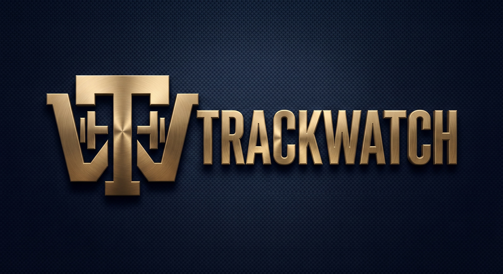

# TrackWatch: AI-Powered Weightlifting Tracker

<div align="center">
  
</div>

<p align="center">
  <em>Compatibility Note: This application is designed for Android Wear OS smartwatches (Wear OS 3.0 / API Level 30 and above).</em>
</p>

The goal of this project is to automatically recognize and count weightlifting exercises (Push-ups, Squats, Pull-ups, etc.) using the inertial measurement unit (IMU) sensors of an Android Wear OS smartwatch.

## Description

The raw signal from the smartwatch is a multivariate time series containing 3-axis acceleration and 3-axis angular velocity:

$$
S(t) = [A_x(t), A_y(t), A_z(t), G_x(t), G_y(t), G_z(t)]
$$

The project architecture is divided into two distinct components: a strict digital signal processing (DSP) pipeline to structure the data, followed by a Deep Learning model for temporal classification.

### 1. Data Preprocessing Pipeline

Android sensor events are event-driven, irregular, and highly susceptible to mechanical noise. The preprocessing pipeline aims to transform these raw inputs into structured 3D tensors.

#### 1.1 Resampling and Filtering

The data is first mathematically resampled using linear interpolation to achieve a constant sampling rate of $f_s = 50 \text{ Hz}$.
To isolate human motion from mechanical shocks, a 4th-order low-pass Butterworth filter is applied to the signal.

#### 1.2 Endpoint Detection (Intelligent Cropping)

To prevent the neural network from learning the "rest" or "setup" phases of the recording, the signal is automatically trimmed. We compute the signal magnitude for both sensors:

$$
M(t) = \sqrt{X(t)^2 + Y(t)^2 + Z(t)^2}
$$

We then use a Short-Time Autocorrelation (STAC) algorithm over a sliding window of size $W$ to detect rhythmic movement. The discrete local autocorrelation for a given lag $\tau$ is defined as:

$$
R(t, \tau) = \sum_{n=t}^{t+W} M(n) \cdot M(n+\tau)
$$

To account for exercises that are either purely linear (Squats) or highly rotational (Bicep Curls), we use a sensor fusion approach. The algorithm calculates the periodicity score for both the accelerometer and the gyroscope, retaining the maximum value:

$$
Score(t) = \max(R_{acc}(t,\tau), R_{gyr}(t,\tau))
$$

The recording is trimmed to keep only the continuous timeframe where $Score(t) > \text{Threshold}$.

#### 1.3 Sliding Windows (Tensor Creation)

The continuous signal is sliced into overlapping fixed-size windows to create the input tensors.
With a shift step defining a $50$ % overlap, an exercise repetition occurring between two timeframes is guaranteed to be fully captured, preserving the chronological sequence required by the neural network.

### 2. Machine Learning Architecture

The classification of the structured windows is handled by a hybrid **1D CNN + LSTM** Deep Learning architecture.

*   **Feature Extraction (1D CNN):** A 1D Convolutional Neural Network is applied across the time dimension to automatically extract spatial features and local patterns (e.g., sudden acceleration peaks, smooth deceleration curves) from the 6-channel raw IMU data without manual feature engineering.
*   **Temporal Dynamics (LSTM):** Long Short-Term Memory layers process the sequence of features extracted by the CNN. The LSTM is crucial for capturing the chronological evolution of the exercise (differentiating the eccentric phase from the concentric phase).
*   **Null Class Rejection:** The output layer uses a Softmax activation function. A critical aspect of the training phase is the inclusion of a "Null Class" (Resting/Walking/Random Arm Movements) to act as a noise rejection threshold, preventing false positives when the user is not actively exercising.

## Before executing the code

If you have the permission, you will first need to clone the repository:

```bash
git clone git@github.com:AdamBo-cs/TrackWatch.git
```

### 1. PC Configuration

Install the Python packages needed through pip:

```bash
pip install -r requirements.txt
```

### 2. Android App Configuration

Before installing the app on the watch, you must update the IP address to match your PC's local IP address (e.g., `192.168.X.X`) so the watch can send the data.
Open the project in Android Studio and update the `pcIpAddress` variable in:

*   `app/src/main/java/.../MenuLocalActivity.kt`
*   `app/src/main/java/.../EnregistrementActivity.kt`

### 3. Smartwatch Installation (Wireless ADB)

To install the application directly onto your Wear OS smartwatch over Wi-Fi, you must enable **Developer Options** and **Wireless Debugging** on the watch. The connection is a two-step process:

**Step 1: Pairing**
Navigate to "Pair new device" in the watch's Wireless Debugging menu. Note the IP, Port, and Wi-Fi pairing code displayed. In your terminal, run:

```bash
adb pair 192.168.X.X:PORT
```

*(You will be prompted to enter the Wi-Fi pairing code).*

**Step 2: Connecting and Installing**
Go back to the main Wireless Debugging screen on the watch and note the new connection Port (it is different from the pairing port). Run:

```bash
adb connect 192.168.X.X:NEW_PORT
adb install app/build/outputs/apk/debug/app-debug.apk
```

### 4. Run the Server

Finally, run the local PC server and wait for the smartwatch data transmission:

```bash
python serveur_pc/serveur_fichiers.py
```

## Roadmap

*   [x] **Objective 1: Data Collection and Wear OS App**
    *   UI implementation for exercise selection and countdown
    *   High-frequency recording of Accelerometer and Gyroscope
    *   Local CSV saving and UDP/TCP transmission to PC
*   [x] **Objective 2: Signal Processing Pipeline**
    *   Interpolation to constant timestamp steps (50 Hz)
    *   Low-pass filtering to remove sensor noise
    *   Automated STAC cropping using sensor fusion
    *   Overlapping sliding windows for tensor creation
*   [ ] **Objective 3: Repetition Counting via Autocorrelation**
    *   Implementation of continuous rhythm analysis to extract repetition periods
    *   Replacing discrete state machines with mathematical STAC evaluation
*   [ ] **Objective 4: Artificial Intelligence Implementation**
    *   Creation of a "Null Class" (Rest/Walking) to prevent false positives
    *   Development and training of a 1D CNN
    *   Development and training of a hybrid 1D CNN + LSTM model
*   [ ] **Objective 5: On-device Deployment**
    *   Exporting the trained model to TensorFlow Lite (TFLite)
    *   Running local inferences directly on the Wear OS device
